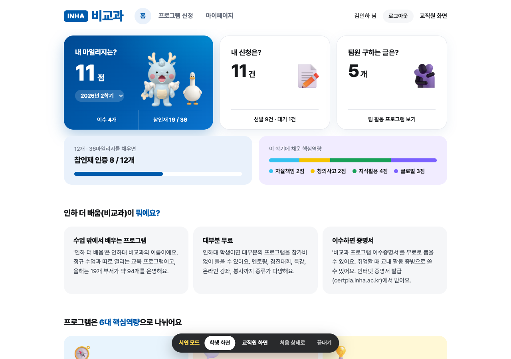
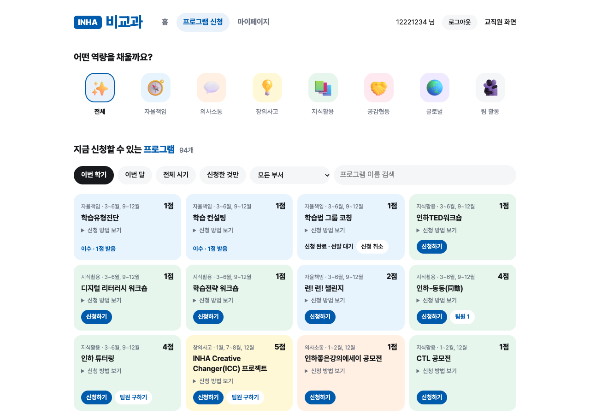
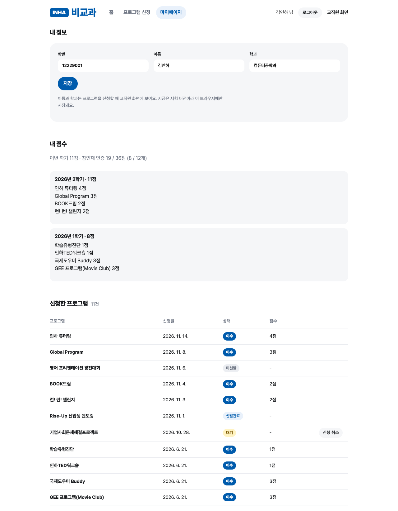
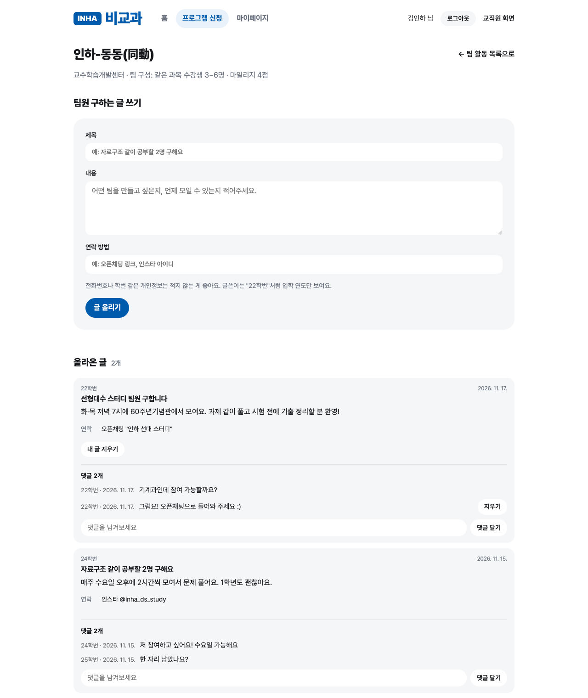

<p align="center">
  
</p>

<h3 align="center">인하대 비교과 프로그램을 한눈에 보고, 내 예상 마일리지를 바로 확인</h3>

<p align="center">
  <a href="https://yurimirimiq.github.io/inha-extracurricular/"><b>바로 보기 →</b></a>
</p>

> 학교 공식 서비스가 아닌 학생 프로젝트입니다.

## 미리 보기

| 홈 | 프로그램 신청 |
| --- | --- |
|  |  |

| 마이페이지 | 팀원 구하기 |
| --- | --- |
|  |  |

## 화면

| 화면 | 파일 | 하는 일 |
| --- | --- | --- |
| 홈 | `index.html` | 내 마일리지 요약, 비교과·마일리지 설명 |
| 프로그램 신청 | `programs.html` | 프로그램 목록 보기·고르기·신청 (학생은 신청만, 점수는 교직원이 부여) |
| 팀원 구하기 | `team.html` | 팀 프로그램별 팀원 모집 글 쓰기, 글마다 댓글 |
| 마이페이지 | `mypage.html` | 이름·학과, 내 점수, 신청한 프로그램 목록, 내 글·댓글 관리 |
| 로그인 | `login.html` | 시험 버전: 학생·교직원이 같은 화면에서 학생은 학번, 교직원은 사번과 비밀번호로 로그인. 아무 값이나 통과, 비밀번호는 저장 안 함 |
| 교직원 | `admin.html` | 활동별 신청 인원 보기, 활동에 들어가 선발·마일리지 부여, 새 비교과 활동 등록 (시연용, 가짜 데이터) |

신청·교직원 데이터는 **이 브라우저에만** 저장됩니다. 팀원 구하기 글·댓글은 아래 "게시판 서버 연결"을 하면 모두에게 보이고, 하기 전에는 이 브라우저에만 저장됩니다.

## 폴더

```
.
├── index.html  programs.html  mypage.html  team.html  login.html  admin.html
├── css/
│   └── style.css      모든 화면이 같이 쓰는 꾸밈
├── js/
│   ├── data.js        프로그램 목록 (2026 가이드북 기준)
│   ├── logic.js       마일리지 계산
│   ├── config.js      게시판 서버(Supabase) 주소와 공개 키. 비어 있으면 서버 없이 동작
│   ├── board.js       팀원 구하기 글·댓글 저장 (서버 또는 이 브라우저)
│   ├── common.js      로그인 확인·저장 (홈·신청 화면 공용)
│   ├── home.js  programs.js  mypage.js  team.js  admin.js   화면별 코드
│   └── test.js        검사
├── supabase.sql       게시판 서버에 한 번 실행하는 표 설정
└── assets/
    ├── icons/         3D 이모지 그림
    ├── screenshots/   README에 쓰는 화면 그림
    └── mascot/        인하대 마스코트 그림
```

프로그램을 고치거나 추가할 때는 `js/data.js`만 수정하면 됩니다.

## 실행

설치할 것 없이 `index.html`을 브라우저로 열면 됩니다.

검사:

```bash
node js/test.js
```

## 게시판 서버 연결

팀원 구하기 글·댓글을 다른 사람도 보게 하려면 [Supabase](https://supabase.com)(무료)에 연결합니다.

1. Supabase에서 프로젝트를 만든다.
2. SQL Editor에 `supabase.sql` 내용을 붙여넣고 실행한다.
3. Project Settings → API의 Project URL과 공개 키(anon 또는 publishable)를 `js/config.js`에 넣는다.

진짜 로그인이 아직 없어서, 글은 누구나 쓸 수 있고 지우기는 그 글을 쓴 브라우저에서만 됩니다. 학번 전체는 서버로 보내지 않고 "22학번" 같은 표시만 저장합니다.

## 그림 출처

- `assets/icons/` — Microsoft Fluent Emoji (MIT 라이선스, `LICENSE.txt`)
- `assets/mascot/` — 인하대학교 공식 마스코트 안뇽·인덕. 저작권은 인하대학교에 있으며 사용 조건은 폴더 안 `README.txt` 참고
